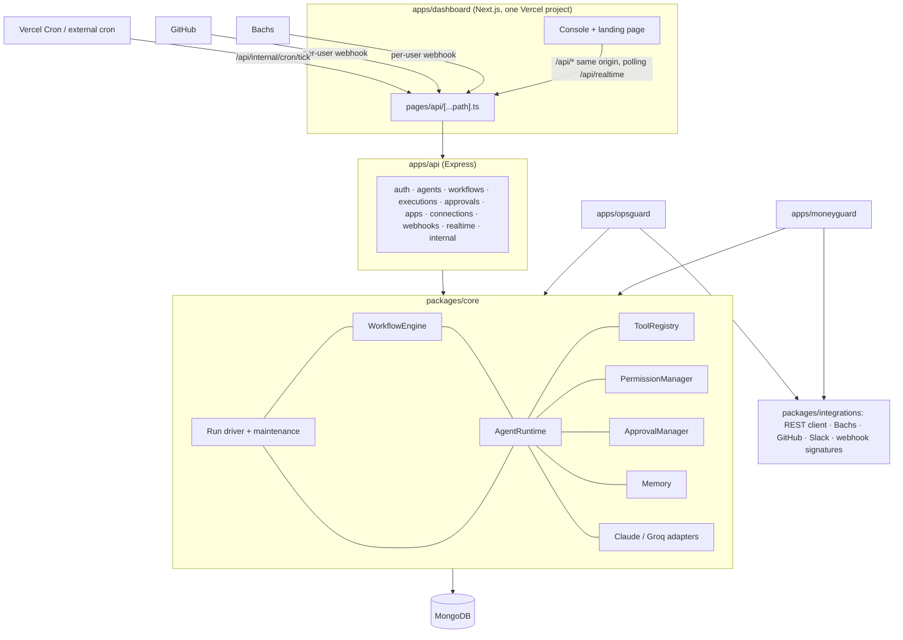
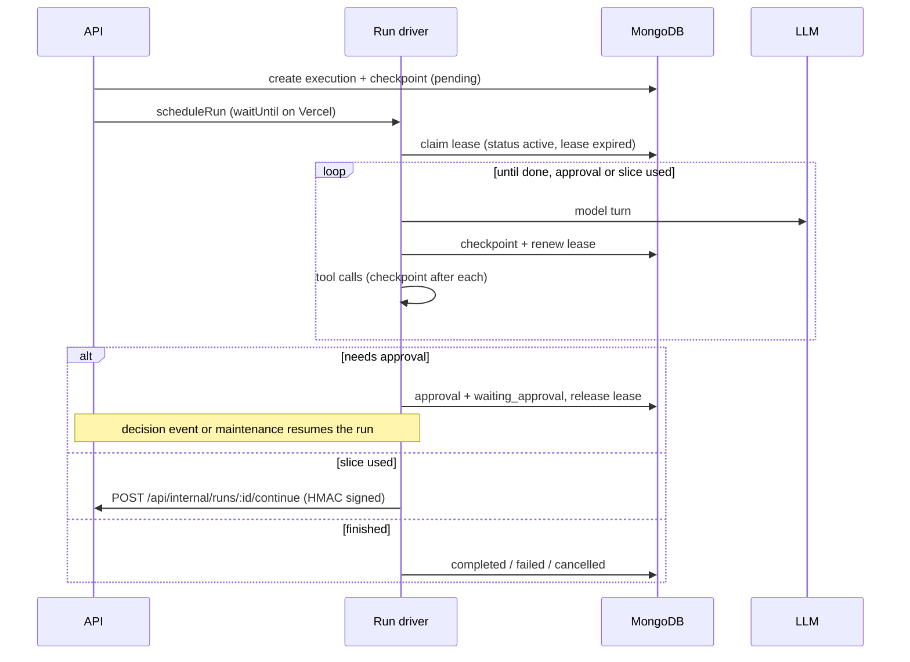

# Design Document

## Overview

Athena is an npm-workspaces monorepo. A shared runtime (`packages/core`) executes agents; applications (`apps/moneyguard`, `apps/opsguard`) contribute only an agent template, tools and workflow templates. An Express API (`apps/api`) exposes the runtime, and the Next.js dashboard (`apps/dashboard`) serves both the UI and that API, so everything deploys as one Vercel project backed by MongoDB Atlas.

Requirements: [requirements.md](./requirements.md). Tasks: [tasks.md](./tasks.md).

## Architecture



| Package | Responsibility |
|---|---|
| `packages/shared` | Errors, logger with redaction, response helpers, Zod helpers, AES-GCM secret box, per-user scope (AsyncLocalStorage) |
| `packages/database` | Connection with explained errors, Mongoose schemas and models |
| `packages/core` | Runtime, tools, permissions, approvals, memory, events, monitor, workflows, LLM adapters, application contract, resumable runs |
| `packages/integrations` | REST client (retries, idempotency keys), connectors, webhook verification, CSV/XML bridge |
| `apps/moneyguard`, `apps/opsguard` | `AthenaApplication` implementations |
| `apps/api` | Express app, bootstrap, serverless handler, standalone server |
| `apps/dashboard` | UI and API host |

## Components and Interfaces

### Application contract

```typescript
interface AthenaApplication {
  id: string; name: string; tagline: string; description: string;
  tools: Tool[];                      // may be shared with other applications
  agent: AgentTemplate;               // prompt, permissions, tool ids, maxIterations
  workflows: WorkflowTemplate[];
  connections: ConnectionRequirement[]; // per-user services, e.g. { provider: 'bachs' }
  env: EnvRequirement[];              // optional operator settings
}
```

`registerApplication()` registers tools (deduplicated by object identity), and `describeApplication(app, connected)` reports readiness from the user's connections.

### Tool

```typescript
interface Tool<I, O> {
  id: string; name: string; description: string;
  inputSchema: ZodSchema<I>;
  permissionLevel: 'low' | 'medium' | 'high'; // high always needs approval
  requiredPermissions: string[];               // e.g. ['write:refunds']
  requiresApproval: boolean;
  handler(input: I, ctx: ToolContext): Promise<ToolResult<O>>;
}
```

### Tool invocation (`AgentRuntime.invokeTool`)

1. Record `tool_call` (skipped when resuming after an approval).
2. Check the tool is assigned and registered.
3. Check permissions; refuse without creating an approval.
4. Validate input with Zod.
5. If approval is needed: first call creates the approval and returns a suspension; the resumed call reads the decision.
6. Execute inside the run owner's connection scope (`withUserScope`), with a timeout; record `tool_result`.

### Resumable runs



- Checkpoint (`execution.stateJson`): `{ kind: 'agent', agent: { system, messages, iteration, pending? } }` or `{ kind: 'workflow', workflow: { scope, currentStepId, stepRuns, step? } }`. Stored as a JSON string so tool inputs with any keys are safe.
- Lease: `leaseId` and `leaseUntil` (3 minutes, renewed at each checkpoint). A lost lease aborts the slice.
- Slice: `RUN_SLICE_SECONDS`, default 200 s on Vercel (limit 300 s), unlimited elsewhere. `Budget` guarantees one unit of work per slice.
- Background work: `setBackgroundRunner(waitUntil)` on Vercel; floating promises on a long-lived server.
- Maintenance (`runMaintenance`): expire approvals, resume stalled or decided runs, start due schedules with a conditional claim on `lastRunAt`. `maybeRunMaintenance` uses a `system_locks` document to run at most once a minute across instances.

### Per-user connections

- `ConnectionModel` stores `secretsEncrypted` (AES-256-GCM, key from `ENCRYPTION_KEY` via HKDF), non-secret `config`, masked `hints`, and a random `webhookToken`.
- `loadUserScope(userId)` decrypts connections into an AsyncLocalStorage scope; `bachs()`, `github()`, `postSlackMessage()` and OpsGuard's `getServices()` read from it and throw `ConnectionMissingError` when absent.
- Webhooks: `/api/webhooks/bachs/:token` and `/api/webhooks/github/:token` look up the connection by token, verify with that user's secret, de-duplicate in `webhook_deliveries` (TTL 1 day) and trigger only that user's workflows.

### Realtime

`GET /api/realtime?since=` returns timeline events, run status changes and approval changes since the cursor (2 s overlap, deduplicated client-side). The dashboard polls every 2.5 s while visible and 15 s when hidden.

## Data Models

| Collection | Key fields |
|---|---|
| `users` | email (unique), password (bcrypt, not selected), name, role, isActive |
| `agents` | name, systemPrompt, modelConfig { provider, model }, permissions[], maxIterations, application, templateVersion, userId |
| `tools`, `agenttools` | tool metadata; agent ↔ tool assignment with enabled flag |
| `workflows` | agentId, trigger { type, config }, steps[], status, lastRunAt, templateKey, userId |
| `executions` | agentId, workflowId, trigger, status, task, result, error, iterations, toolCallCount, usage, cancelRequested, stateJson, leaseId, leaseUntil, userId |
| `executionevents` | executionId, timestamp, type, tool, input, output, status, metadata |
| `memories` | agentId, executionId, type (context, conversation, fact, decision), content, metadata, expiresAt (TTL) |
| `approvals` | executionId, requestedAction { tool, input, reason }, status, reviewerId, expiresAt, userId |
| `connections` | userId + provider (unique), secretsEncrypted, config, hints, webhookToken (unique), status, lastVerifiedAt, lastWebhookAt |
| `moneyguard_cases` | userId, executionId, chargeId, customerEmail, disputeId, title, summary, riskLevel, recommendedAction, status |
| `webhook_deliveries` | delivery key, createdAt (TTL 1 day) |
| `system_locks` | lock name, last run time |

## API

| Area | Endpoints |
|---|---|
| Auth | `POST /api/auth/register`, `/login`, `/logout`, `GET /api/auth/me` |
| Agents | CRUD `/api/agents`, `POST /api/agents/:id/run`, `GET /api/agents/:id/memory` |
| Workflows | CRUD `/api/workflows`, `POST /api/workflows/:id/run` |
| Runs | `GET /api/executions`, `/stats`, `/:id`, `POST /:id/cancel` |
| Approvals | `GET /api/approvals`, `POST /api/approvals/:id/decision` |
| Applications | `GET /api/apps`, `POST /api/apps/:id/install`, MoneyGuard payments/cases/investigate, OpsGuard overview/investigate |
| Connections | `GET /api/connections`, `PUT/DELETE /api/connections/:provider`, `POST /:provider/test` |
| Webhooks | `/api/webhooks/bachs/:token`, `/github/:token`, `/workflows/:id` (HMAC `x-athena-signature`) |
| Platform | `GET /api/health`, `GET /api/realtime`, `POST /api/internal/runs/:id/continue`, `GET /api/internal/cron/tick` |

## Error Handling

- Domain errors extend `AppError` with an HTTP status; the error middleware maps them to `{ success: false, error: { message, code } }`.
- MongoDB outages return 503 with an explanation (for example the Atlas IP access list); `/api/health` reports the reason and the dashboard shows it.
- Tool failures go back to the model as tool results; run failures are recorded as an `error` event and `failed` status.
- Configuration errors in production (short `JWT_SECRET` or `ENCRYPTION_KEY`) are returned by every API request instead of crashing the function.

## Security

- Least privilege per agent; approvals for high-risk tools; owner-only decisions.
- Secrets in environment variables or encrypted per user; logger redaction; masked hints only.
- Health checks follow no redirects and refuse private addresses in production; Slack URLs limited to `hooks.slack.com`; GitHub limited to the connected repository; log files limited to an operator allowlist.
- Webhooks verified with HMAC (Bachs V2 and legacy headers with 300 s tolerance, GitHub `x-hub-signature-256`, per-workflow secrets).

## Testing Strategy

Test scripts run against an in-memory MongoDB and the real compiled packages, with a scripted model client where an LLM is needed:

- Runtime: tool loop, permissions, validation, approvals, rejection, cancellation, workflows, templates.
- Bachs: documented response shapes from a local server, signature verification against the official SDK.
- API smoke and connections: auth, apps, workflows, webhooks, per-user isolation, encryption at rest, masking.
- Resumable runs: slices, lost continuations, cross-process approvals, expiry, concurrent drivers, cancel between slices, schedule claims.
- Address guard: private ranges, DNS resolution to private IPs, overrides.
- Browser checks (Puppeteer): page rendering, no console errors, no horizontal overflow, back navigation.
